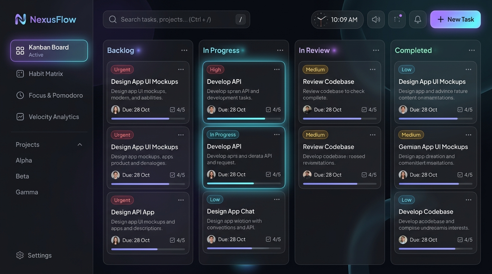
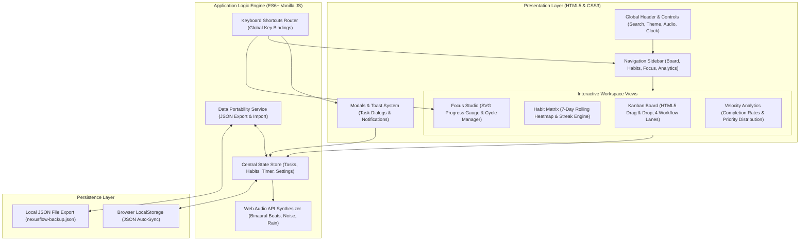

<div align="center">

# ⚡ NexusFlow

### Modern Productivity Workspace & Ambient Focus Studio

A lightweight, zero-dependency, privacy-first productivity suite engineered for developers and creators. NexusFlow combines an interactive Kanban workflow, daily habit discipline matrix, ambient Pomodoro timer with native Web Audio synthesis, and velocity analytics — all running 100% locally in your browser.

[](https://github.com)
[](https://github.com)
[](https://github.com)
[](https://github.com)
[](LICENSE)

<br/>



</div>

---

## 💡 Why NexusFlow?

Most modern task trackers are bloated with slow electron wrappers, cloud logins, paywalled features, and background tracking. **NexusFlow** was built with a different philosophy:

- **Instant Zero-Build Execution**: Pure HTML5, modern CSS3, and ES6+ JavaScript. No `npm install`, no bundlers, no build step.
- **100% Privacy & Offline-First**: All your tasks, habits, and sessions are saved locally via browser `localStorage`. Your data never touches a third-party server.
- **Hardware-Synthesized Audio**: Built-in sound generator using the browser's native **Web Audio API** (40Hz Gamma Binaural Beats, Brown Noise, Rain) without streaming large audio files.
- **Keyboard-First Workflow**: Seamlessly jump between tasks, boards, and focus sprints with fluid keyboard shortcuts.

---

## 🌟 Core Modules

### 📋 1. Interactive Kanban Board
- **4-Lane Workflow**: Organize your work across *Backlog*, *In Progress*, *In Review*, and *Completed*.
- **Drag-and-Drop & Mobile Selectors**: Native HTML5 drag-and-drop with responsive quick-move dropdowns for mobile and keyboard users.
- **Priority & Tag Filtering**: Instantly isolate tasks by priority (*Urgent*, *High*, *Medium*, *Low*), categories, or keyword search.
- **Global Quick Search**: Press <kbd>/</kbd> anywhere to search tasks, tags, and habit titles in real-time.

### ⚡ 2. Habit Discipline Matrix
- **7-Day Rolling Heatmap**: Visually monitor daily consistency with an intuitive rolling 7-day adherence matrix.
- **Categorized Routines**: Pre-configured and customizable categories (Engineering, Mind & Learning, Fitness & Health, Focus & Flow).
- **Streak & Adherence Telemetry**: Real-time weekly consistency percentages and current streak counters for each habit.

### ⏱️ 3. Focus & Pomodoro Studio
- **Configurable Sprint Modes**: 25m *Deep Work*, 5m *Short Break*, and 15m *Long Recharge*.
- **Smooth SVG Progress Gauge**: Real-time circular progress animation with remaining time countdown.
- **Synthesized Ambient Audio**: Zero external audio dependencies. Uses procedural oscillators and noise filters to generate:
  - **40Hz Gamma Binaural Beats** (proven to aid deep focus and working memory)
  - **Deep Brown Noise** (calming sound masking for busy environments)
  - **Ambient Rain Soundscape**
- **Active Task Linking**: Connect any Kanban task directly to your current focus sprint.

### 📊 4. Velocity Analytics
- **Work Breakdown Metrics**: Real-time distribution charts by task status and urgency level.
- **Sprint Telemetry**: Total focus hours logged, completed sprint sessions, and task completion velocity.

---

## 🏛️ System Architecture

NexusFlow follows a clean, decoupled architecture separating UI presentation, core state reactivity, Web Audio synthesis, and browser persistence:



---

## 🚀 Quick Start

NexusFlow requires no installation, dependencies, or compile step.

### Option 1: Development Server (Recommended)

Run a local server with Python or Node.js:

```bash
# Using Python
python -m http.server 3000

# Or using Node.js / npx
npx serve .
```

Open **`http://localhost:3000`** in any modern web browser.

### Option 2: Direct Launch

Simply open **`index.html`** directly in your browser (Google Chrome, Firefox, Safari, Microsoft Edge, Brave).

---

## ⌨️ Keyboard Shortcuts

Speed up your daily workflow with built-in hotkeys:

| Shortcut | Action |
| :--- | :--- |
| <kbd>Ctrl</kbd> + <kbd>N</kbd> / <kbd>⌘</kbd> + <kbd>N</kbd> | Open **New Task** modal |
| <kbd>/</kbd> | Focus **Global Search** input |
| <kbd>Space</kbd> | Start / Pause **Pomodoro** timer |
| <kbd>1</kbd> | Switch to **Kanban Board** |
| <kbd>2</kbd> | Switch to **Habit Matrix** |
| <kbd>3</kbd> | Switch to **Focus Studio** |
| <kbd>4</kbd> | Switch to **Velocity Analytics** |
| <kbd>Esc</kbd> | Dismiss active modal or clear search |

---

## 💾 Data Portability & Privacy

- **Automatic Local Storage**: Every update (moving a card, checking off a habit, completing a sprint) is instantly saved to your browser's `localStorage`.
- **JSON Backup & Restore**: Full data export and import tools allow you to backup your workspace or migrate between devices in seconds.
- **No Cloud Required**: 100% of the code executes on your device.

---

## 🛠️ Tech Stack

| Component | Technology | Description |
| :--- | :--- | :--- |
| **Markup** | HTML5 | Accessible, semantic elements with ARIA dialog roles |
| **Styling** | Vanilla CSS3 | Custom HSL design tokens, glassmorphism, responsive Grid & Flexbox |
| **Logic** | Vanilla ES6+ | Modular state store, reactive event dispatcher, zero frameworks |
| **Sound** | Web Audio API | Low-latency oscillator nodes, biquad filters, and procedural noise |
| **Storage** | Web Storage API | Client-side persistent key-value cache |

---

## 📄 License

This project is licensed under the [MIT License](LICENSE) — free for personal and commercial use.


